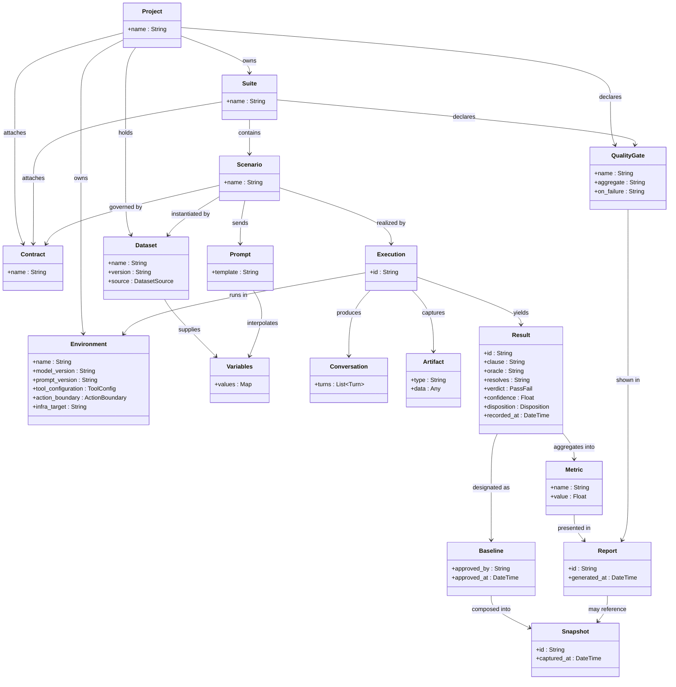
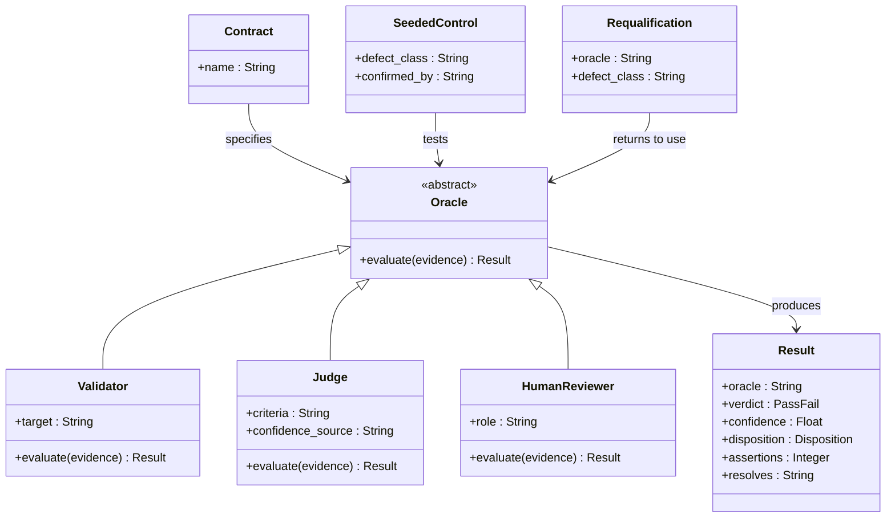
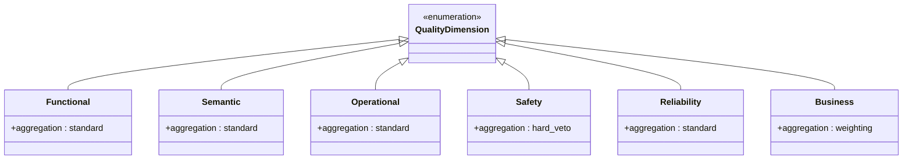
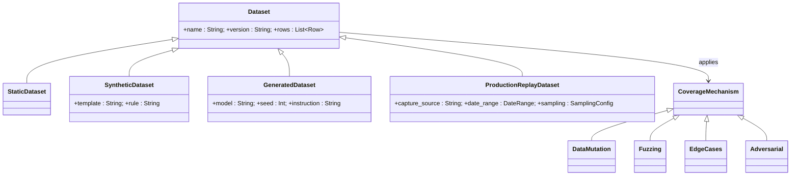
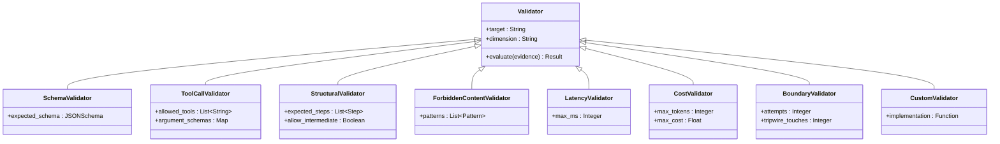
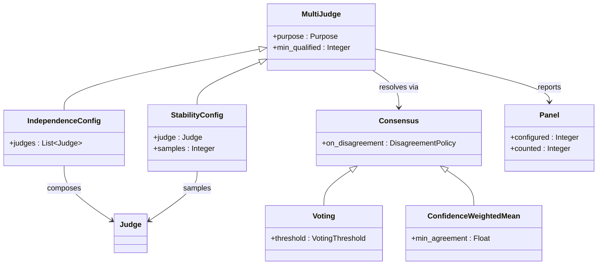
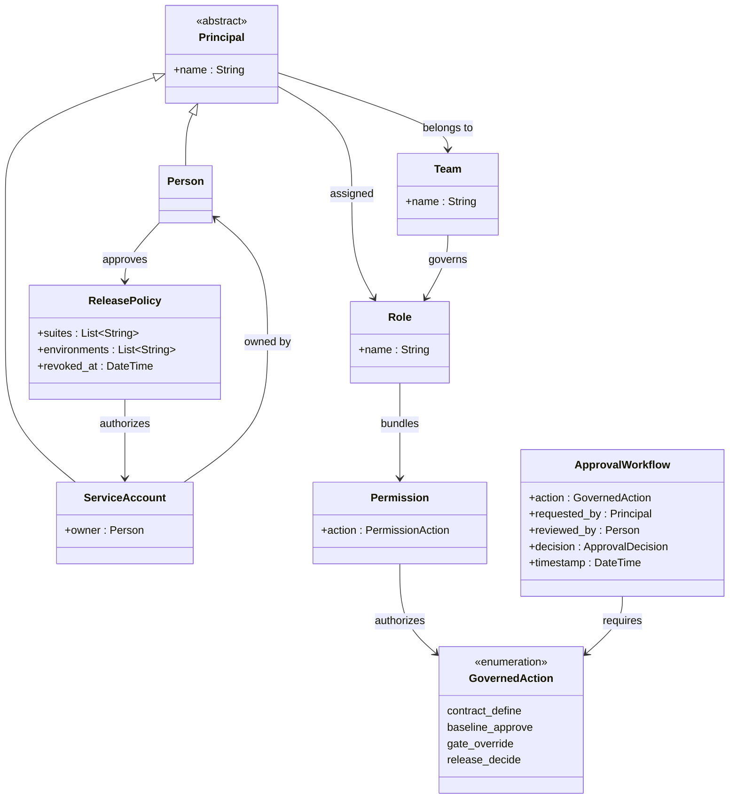
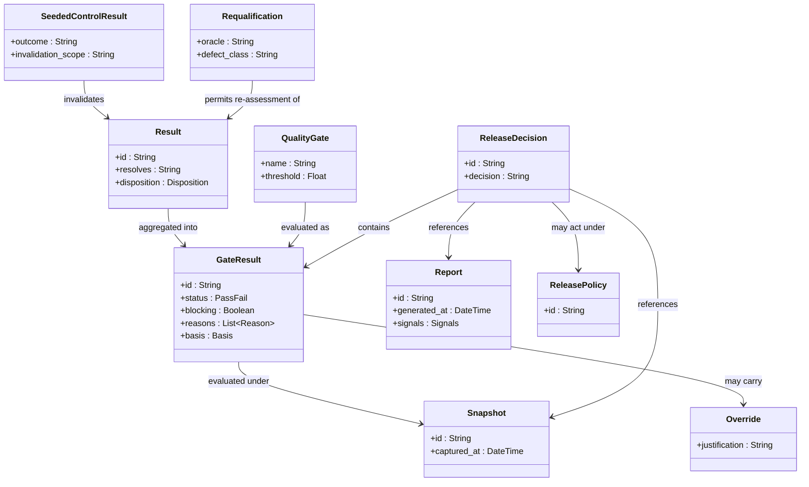

# Appendix E — UML Diagrams

This appendix provides UML class diagrams visualizing the structural relationships
defined across the specification. Each diagram restates — in visual form — what the
referenced Volumes specify in prose; the Volumes remain authoritative. Diagrams use
Mermaid syntax for inline rendering.

## E.1 — Domain Model: Core Entities

The complete entity graph from Volume II, with the levels at which Contracts and Quality
Gates attach (Appendix A §A.1, §A.3). Arrows read as "owns," "produces," or
"references." `Result`'s fields are abbreviated here for diagram readability — Appendix
C §C.7 is the authoritative shape. A Result may name, in `resolves`, an earlier Result
for the same Execution and clause (Volume I, Chapter 6 — Result Resolution).

## E.2 — Oracle Hierarchy

The three concrete Oracle types and their relationship to Contracts, Results, Seeded
Controls, and requalification (Volume II, Volume V, Volume VI, Volume VIII).

## E.3 — Quality Dimensions

The six Quality Dimensions (Volume I, Chapter 2), their primary assessment mechanism,
and their role in the Aggregation Model. A clause's `dimension` (Appendix A §A.5) places
its Results in one of the first four.

## E.4 — Dataset Taxonomy

Dataset source types and coverage mechanisms (Volume IV).

## E.5 — Validator Engine: Built-in Types

The built-in Validator types and their specialization (Volume V).

## E.6 — Multi-Judge Configuration

Two distinct purposes for running multiple Judges, their Consensus, and the panel a
Result reports (Volume VI).

## E.7 — Governance Model

Principals, Teams, Roles, Permissions, the Approval Workflow, and standing release
policies (Volume XII).

## E.8 — From Results to a Release Decision

The records the Decision Pipeline produces and reads (Volume I, Chapter 6; Appendix A
§A.12–A.14; Appendix C §C.3, §C.10).

