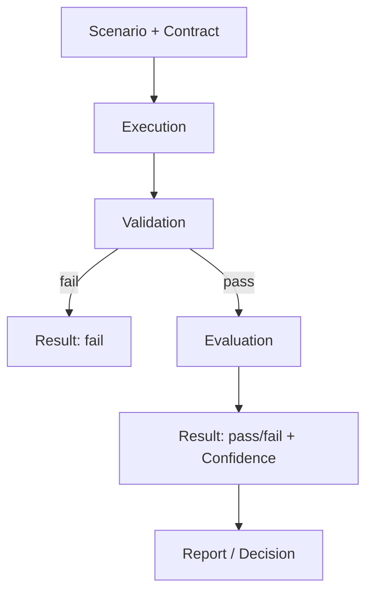

# Appendix K — Quick Start Guide

This appendix provides a practical, step-by-step path to running your first
AQEF-governed quality check against an AI system. It assumes the reader has access to a
conformant AQEF engine (Minimal or Enterprise, Volume XVII) and wants to understand what
the specification requires at each step — not how to build the engine itself.

The full specification comprises 17 Volumes and 10 other Appendices; this guide covers
only the minimum viable path. References to specific Volumes and Chapters are included
so the reader can deepen understanding of any step. Every configuration shown is complete
and valid under Appendix A; together, Steps 1 to 3 form one working configuration, kept
here as three fragments — a Project, a Suite, and a reusable Contract — the way
Appendix A §A.1 allows Suites and Contracts to live in separate files.

## Step 1 — Define the Project and Environment

Every AQEF engagement begins with two entities (Volume II):

- **Project** — the top-level container for everything: Suites, Environments,
  Datasets, Reports.
- **Environment** — the specific AI system configuration under test: model version,
  prompt version, tool configuration, infrastructure target.

A single Project MAY have many Environments (e.g., staging vs. production, GPT-4o vs.
Claude 3.5).

```yaml
project:
  name: "my-chatbot-qa"
  environments:
    - name: staging
      model_version: "gpt-4o-2024-08-06"
      prompt_version: "v2.3"          # Pins the system-side instructions
      tool_configuration: null        # Single LLM: no tools, so no Action Boundary
      infra_target: "us-east-1"
```

## Step 2 — Write Your First Scenario

A Scenario is the static definition of what to test — a Prompt, optional Variables, and
the Quality Contract that says what "acceptable" means (Volume II, Volume VII). Every
Scenario needs a Contract; here it refers to one by name, defined in the next step.

Start with something simple: a single-turn question where you know what a good answer
looks like.

```yaml
suite:
  name: "core-qa"
  scenarios:
    - name: "capital-of-france"
      prompt:
        template: "What is the capital of France?"   # The stimulus (Appendix A §A.4)
      contract: basic-correctness                     # Defined in Step 3
```

## Step 3 — Attach a Quality Contract

A Quality Contract is the heart of AQEF — the declarative specification of what an
Oracle checks and what threshold makes a Result actionable (Volume VII).

A Contract contains two kinds of clauses, each bound to exactly one Oracle:

- **Constraint** — a deterministic rule checked by a Validator (Functional Quality).
- **Expectation** — a criterion assessed by a Judge, a Multi Judge panel, or a Human
  Reviewer (Semantic Quality).

A Contract may also carry **Policies**. A Policy is not a clause: it states how the
clauses combine — for example, that every Constraint must pass (Volume VII).

For your first test, start with one Constraint (structural) and one Expectation
(semantic):

```yaml
contract:
  name: "basic-correctness"
  constraints:
    - validator: schema
      target: response
      expected:
        type: string
        minLength: 1
  expectations:
    - criteria: >
        The response correctly identifies Paris as the capital of France.
        It should be factually accurate and not contain fabricated information.
      judge:
        model: "claude-sonnet-4-20250514"   # Not the subject's model family
        confidence_source: self_rating
      confidence_threshold: 0.8
```

The Constraint ensures the response is a non-empty string (cheap, deterministic — a
Validator handles this). The Expectation asks a Judge whether the answer is
semantically correct. The threshold of 0.8 does not decide pass or fail; the Judge's
verdict does. The threshold decides whether that verdict can be used at face value: at
0.8 or above, the Result is `actionable`; below it, the Result is `inconclusive` and MAY
go to a Human Reviewer (Volume I, Chapter 6).

## Step 4 — Run an Execution

An Execution is the runtime event of running a Scenario in a specific Environment
(Volume III). The Execution Engine:

1. Resolves Variables from the Dataset (if any).
2. Constructs the Prompt.
3. Sends it to the AI system via the Conversation Engine.
4. Captures the Conversation and any Artifacts (logs, token counts, latency).

For a Minimal Engine (Volume XVII), this is typically a single API call:

```
POST /projects/my-chatbot-qa/executions
{
  "suite": "core-qa",
  "environment": "staging"
}
```

Executions are triggered per Suite and Environment, and run asynchronously: the
response returns a batch identifier to poll (Appendix C §C.3). Each Execution produces a
Conversation — the actual Prompt/Response transcript — and zero or more Artifacts (token
usage, latency measurements, tool-call traces).

## Step 5 — Validation (Deterministic Check)

The Validator Engine (Volume V) runs first — always (Validation before Evaluation,
Volume I, Chapter 3). It checks Constraints from the Contract against the captured
Conversation and Artifacts.

In this example, the Schema Validator confirms the response is a non-empty string.

- If Validation fails: the Result is recorded and the Execution short-circuits. No
  Judge runs — there is no value in semantically assessing a structurally broken
  response.
- If Validation passes: the Execution proceeds to Evaluation.

Validator Results are deterministic and carry no Confidence — a pass is a pass, a fail
is a fail.

## Step 6 — Evaluation (Semantic Check)

The Judge Engine (Volume VI) runs only after Validation passes. It assesses
Expectations from the Contract — in this case, whether the response correctly
identifies Paris as the capital of France.

A Judge Result always carries Confidence — a number expressing how sure the Judge is of
its own verdict. If the Confidence is below the threshold set in the Expectation (0.8 in
our example), the Result is treated as inconclusive and MAY be routed to a Human
Reviewer.

For the Independent Oracles principle (Volume I, Chapter 3), the Judge MUST NOT be the
same model as the system under test, and SHOULD NOT be from the same model family where
this can be avoided.

## Step 7 — Read the Results

Every Execution produces one or more Results (Volume II). Each Result records:

- **Verdict:** pass or fail.
- **Confidence:** how certain the Oracle is (`"not_applicable"` for Validators).
- **Disposition:** whether the Result can be used at face value: `actionable`,
  `inconclusive`, or not yet available (`awaiting_review`, `oracle_unavailable`,
  `not_assessed`).
- **Evidence:** what the Oracle based its judgment on.

The Judge's Result for this Scenario might read (Appendix C §C.7):

```yaml
result:
  id: res-0001-e0
  execution: exec-0001
  clause: basic-correctness@1/expectations[0]
  oracle_type: judge
  oracle: judge:claude-sonnet-4-20250514@basic-correctness-1
  verdict: pass
  confidence: 0.91
  disposition: actionable        # 0.91 meets the 0.8 threshold
  supporting_evidence:
    excerpt: "The capital of France is Paris."
```

For a single Scenario, you now have a Validator Result and a Judge Result. Together,
they tell you whether the AI system's response to "What is the capital of France?" met
your Quality Contract.

## Step 8 — Scale Up

Once the single-Scenario path works, AQEF's value emerges through scale:

1. Add more Scenarios to the Suite — cover edge cases, negative tests, safety checks
   (Volume VIII, Volume IX).
2. Add a Dataset to run the same Scenario with many different inputs (Volume IV) —
   static rows, synthetic expansion, or production replay.
3. Establish a Baseline — designate one Result as the reference point for regression
   detection (Volume X).
4. Add Quality Gates — define thresholds that must pass before a release (Volume I,
   Chapter 6).
5. Integrate with CI/CD — run Suites automatically on every deployment (Volume XIII).

## The Minimum Viable AQEF Loop

The diagram below shows the minimum path from definition to decision:



This is a single pass through the Quality Lifecycle (Volume I, Chapter 5). Without
Quality Gates, the loop ends in a Report; a formal Release Decision needs at least one
Gate (Step 8, item 4). As your test
suite grows, each pass feeds the next: failures become new Scenarios, Results become
Baselines, and the loop closes.

## What This Guide Does Not Cover

This guide showed the shortest path through AQEF. The full specification covers
significantly more:

- Multi-Judge configurations for higher-stakes assessments (Volume VI).
- Dataset generation and mutation for broad coverage (Volume IV).
- Governance, Roles, and Approval Workflows for team-based quality management (Volume
  XII).
- Plugin Architecture for extending Validators, Judges, and Datasets (Volume XVI).
- Reporting and Analytics for trend analysis and historical comparison (Volume XI).

Start with one Scenario, one Contract, and one Environment. Let complexity grow from
real needs, not upfront architecture.
