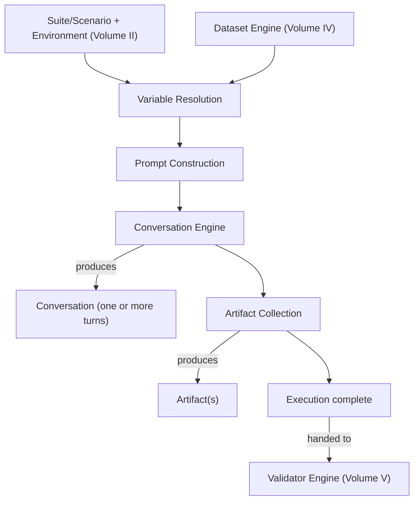

# Volume III — Execution Engine

*Question answered:* How tests are executed.

Chapter 4 named the Execution Engine as the component that triggers Executions, manages
runtime concerns (scheduling, parallelization, retry, timeouts), produces Conversations
via a Conversation Engine sub-component, and collects Artifacts (Volume I). Chapter 5
named Execution as the lifecycle stage where the Probabilistic Subject actually runs
(Volume I). This Volume specifies the mechanics behind both: given a Scenario, its
Variables, and an Environment (Volume II), how the Execution Engine produces exactly one
Conversation and zero or more Artifacts — and does so in a way that keeps Chapter 3's
Deterministic Infrastructure principle true in practice, not just in name, regardless of
how many Executions run concurrently, where they run, or what goes wrong at the
infrastructure level along the way.

## Execution Pipeline

An Execution moves through the same five stages regardless of Environment, Scenario
pattern (Volume I, Chapter 7), or scale:

Variable Resolution and Prompt Construction happen once per Execution for a single-turn
Scenario, and once per turn for a multi-turn or agentic one (Volume I, Chapter 7 — AI
Agent, Multi-Agent). Artifact Collection runs alongside the Conversation Engine rather
than as a pass afterward, since some Artifacts — a tool's raw response, a retrieved
document — exist only transiently during the turn that produced them (see Artifact
Collection, below). An Execution is complete once the Conversation Engine has no further
turns to produce; what happens after that point — Validation, Evaluation — belongs to
Volume V and Volume VI, not this one.

One kind of Scenario does not go through these stages. A Seeded Control that carries
fixed Evidence (Volume VIII; Appendix A §A.4) is executed without invoking the subject:
the Execution belongs to the same batch and Environment as the others, but the Execution
Engine supplies the control's recorded Conversation and Artifacts directly to Validation
and Evaluation instead of producing them. No other Scenario may carry fixed Evidence, and
such an Execution, like every Seeded Control, is excluded from Aggregation (Volume I,
Chapter 6).

Invoking the subject has a cost, so before it does, an implementation SHOULD check for
what would leave a run's Results unusable by any Gate, and report it to the requester:

- a blocking Quality Gate applicable to the Suite whose dimension no clause of that
  Suite counts toward, so that the Gate cannot pass on this run;
- a Judge named by the Suite's Contracts that cannot be reached.

Where a Judge cannot be reached, the implementation SHOULD NOT start the run unless the
request asks it to proceed. A Gate that no clause anywhere in its scope can feed is not
a matter for this check: it is rejected when the configuration is loaded (Volume I,
Chapter 6).

## Runtime

The Runtime is the concrete process that hosts one Execution while it runs: it resolves
an Environment's named configuration (model version, prompt version, tool configuration,
infra target — Volume II) into an actual running instance, and isolates that instance's
state from every other Execution's. Runtime is not Environment: an Environment is a
static, Project-level configuration that does not change; a Runtime is the transient
process that a specific Execution occupies while that configuration is in use. Two
Executions resolving the same Environment MUST get identical configuration from their
respective Runtimes — which physical worker happens to host either one MUST NOT change
what either resolves to, per Deterministic Infrastructure (Chapter 3).

## Action Boundary

Runtime isolates one Execution from another. It does not isolate an Execution from the
world. A subject that can act (call tools, reach a network, submit, write, send) can
reach real systems during a test unless something prevents it, and the moment a test
environment fails is exactly when an agent may look for another way. An Environment
whose `tool_configuration` is not null MUST therefore declare an Action Boundary
(Appendix A §A.2): every system, endpoint, or tool the subject may reach during an
Execution, each marked as a `stub` (a stand-in that only records), a `sandbox` (a
working copy with no effect outside the test), or `real`.

Where the harness controls the subject's access, everything outside the boundary MUST
be denied by default. Where it cannot (the subject runs on a platform the harness does
not control, for instance), the Environment MUST declare the boundary `enforced: false`.
That is not a failure of conformance; it is a fact a Report must show (Volume XI),
because an unsealed Environment is the one in which a test can do real damage.

A `stub` MAY be marked as a Tripwire: a stand-in deliberately made to look like a
tempting shortcut, such as a production-looking endpoint or a URL shortener, which the
subject has no legitimate reason to touch (Volume VIII, Blocked-Path Testing).

This section specifies the declaration, the default, and the recording (Artifact
Collection, below). How a sandbox is built is an infrastructure concern outside this
specification (Scope, §6).

## Scheduling

Scheduling decides when, and in what order, a Suite's Scenarios are triggered as
Executions. It is deliberately a thin layer: it does not decide *what* to test (Test
Design, Chapter 5) or *how much* scrutiny a given Scenario deserves (Risk Analysis,
Chapter 5) — it takes those upstream decisions as given and decides the concrete timing,
whether that means running a Risk-Analysis-prioritized Suite in priority order, running
on a fixed cadence, or triggering on demand from a CI/CD pipeline (Volume XIII). What
Scheduling MUST preserve is that its own decisions are themselves logged and
reproducible — *why* a given Execution ran when it did MUST be reconstructable — even
when the ordering itself is driven by dynamic prioritization rather than a fixed list.

## Parallelization

Parallelization runs multiple Executions concurrently within a Runtime pool to reduce
the wall-clock time a Suite takes. The requirement Deterministic Infrastructure places
on it is specific: Executions running in parallel MUST NOT share mutable Context (see
Context, below) or Variables state with one another — an Execution's outcome MUST depend
only on its own Scenario, Environment, and Variables, never on which other Executions
happen to be running alongside it. Resource contention on a shared, rate-limited
dependency (Chapter 2 — Operational Quality) is a real effect of parallelization, but it
is a performance concern to manage, not something that may be allowed to change which
Conversation a given Execution produces.

## Distributed Execution

Distributed Execution is Parallelization scaled across multiple machines rather than
multiple processes on one — necessary once a Suite or Dataset is large enough that a
single Runtime pool cannot clear it in acceptable time. The same guarantee from
Parallelization holds regardless of physical placement: an Execution's outcome must be
independent of which machine, region, or worker actually ran it. This is exactly the
axis Volume XVII's Minimal Engine and Enterprise Engine differ on — one collapses
everything into a single process, the other distributes it — and Conformance (Front
Matter §10) does not require a specific topology, only that Deterministic Infrastructure
holds wherever an Execution actually runs.

## Retry

A Retry is triggered by an infrastructure-level failure — a network timeout on the
harness's own call, a rate-limit response from a model provider, a crash inside the
Conversation Engine itself — occurring *before* the subject has produced a genuine
Response. A retried Execution of this kind produces no Conversation on the failed
attempt and MUST NOT be treated as if it had; only the successful attempt is the
Execution that produces a Result. This is different in kind from re-running a Scenario
because a Result later came back failing or low-Confidence: that is not a Retry, it is a
second Execution, and the original Execution's Result stands and MUST be recorded, not
discarded in favor of a more favorable second attempt. Treating a bad Result as
grounds for a "do-over" is the Execution-level version of the same failure mode Chapter
1 already named for classical testing — loosened assertions restoring a green build
without restoring any actual check — and Probabilistic Subject and Everything is a Test
(Chapter 3) rule it out here on the same basis. A Scenario accumulating an unusual number
of infrastructure-level Retries is itself worth surfacing to Reporting (Volume XI) as a
Reliability signal, independent of what any individual attempt's eventual Result was.
Retry as specified here is scoped to the Execution stage; an Oracle call that fails
during the later Evaluation stage — after Validation has already passed — is a related
but distinct case Volume VI covers under `oracle_unavailable`, not this section.

## Timeouts

A Timeout is a runtime bound the Execution Engine enforces to abort a turn or an entire
Execution that exceeds an expected duration — an infrastructure safeguard, not a Quality
assessment. It is not the same thing as a latency threshold (Chapter 2 — Operational
Quality): a latency threshold is a Validator-checked Quality Contract clause evaluated
against a *completed* Execution's recorded duration, while an Execution that hits a
Timeout never completes and produces no Conversation to assess at all — it is an
infrastructure failure handled the same way as any other (see Retry, above). An
Execution that finishes slowly but within its Timeout can still go on to fail a latency
Validator; the two operate at different layers, one aborting a run, the other assessing
one that finished.

## Variables

Variables are named parameters, sourced from a Dataset row (Volume IV) or fixed on a
Scenario, that get interpolated into Prompts at Execution time (Volume II). This Volume
adds the pipeline detail Volume II's structural definition does not: interpolation
happens once per turn, at Prompt Construction (see Execution Pipeline, above), and the interpolation step itself is Deterministic Infrastructure — the same Variables and the
same Prompt template MUST produce the same literal Prompt text every time. The template
is the Scenario's `prompt` (Appendix A §A.4); for a multi-turn Scenario it is the opening
turn, and later turns are constructed by the Conversation Engine from Context. All
non-determinism in an Execution is reserved for what the subject does with that Prompt,
never for how the harness fills it in.

## Context

Context is the state an Execution accumulates as its own turns proceed — prior turns'
Prompts and Responses, retrieved documents (RAG, Chapter 7), tool outputs (Tool Calling,
Chapter 7), intermediate agent state (AI Agent, Multi-Agent, Chapter 7) — everything the
Conversation Engine needs on hand to construct the *next* turn's Prompt that is not
itself a fresh Variable. Context is not Variables: Variables are decided before an
Execution starts and come from outside it (a Dataset row, a Scenario's fixed
configuration); Context is produced by the Execution itself as it runs. Context is also
not Environment: an Environment is fixed for the whole Execution and does not change,
while Context accumulates turn by turn. For a Single LLM Scenario, Context is trivial —
nothing has accumulated before the one turn there is. For AI Agent, Multi-Agent, RAG,
and Human-in-the-loop Scenarios, Context is where most of the pattern's distinguishing
behavior actually lives, which is why Volume I, Chapter 7 treats those patterns as
adding *mechanisms*, not as requiring separate infrastructure — the mechanism they add is
almost always a new source that feeds Context.

## Conversation Engine

The Conversation Engine is the sub-component that actually produces the Conversation,
turn by turn, for whichever pattern (Chapter 7) a Scenario represents: a single
Prompt/Response exchange for Single LLM; a retrieval call followed by a generation call
for RAG, with the retrieved content becoming both Context for the generation step and an
Artifact in its own right; a loop of reasoning, tool-call, and observation turns for AI
Agent, each consulting the Context accumulated so far; parallel or sequential exchanges
among cooperating sub-agents for Multi-Agent, each with its own Context, reconciled into
the single Conversation Volume II describes; and turns that pause for external input for
Human-in-the-loop, where that input becomes the following turn's Prompt. Regardless of
pattern, the Conversation Engine's *own* logic — how it decides a Conversation is
complete, how it constructs the next turn's Prompt given the Context accumulated so far —
MUST itself be deterministic given the same Context and Responses so far. The only
genuinely unpredictable ingredient at any step is the subject's own Response; everything
the Conversation Engine does around it is infrastructure, and Chapter 3 does not carve
out an exception for it just because it happens to sit closest to the subject.

## Artifact Collection

Artifact Collection captures everything Volume II's Artifact entity names — logs,
tool-call traces, intermediate agent state, token usage, latency traces, screenshots —
alongside the Conversation as the Execution runs, not reconstructed from it afterward.
It runs concurrently with the Conversation Engine's own work rather than as a separate
pass, because some Artifacts, such as a tool's raw response or a retrieved document,
exist only transiently during the turn that produced them and would not be recoverable
later. What Artifact Collection records about the infrastructure-level facts of a turn —
the exact request a tool call sent, the exact latency observed — MUST itself be captured
deterministically, even where the *content* of what's being recorded (a model-generated
tool argument, a retrieved passage) is part of the probabilistic subject's own output
rather than the harness's.

Where the Environment declares an Action Boundary, Artifact Collection MUST capture every
attempt the subject makes to reach outside it, and every touch of a Tripwire, whether or
not the attempt was blocked. A blocked attempt is not a non-event: it is the clearest
evidence of what the subject would have done, and the Boundary Validator (Volume V)
reads it as such.

---

Together, these twelve concerns are what let Chapter 3's Deterministic Infrastructure
principle be more than a slogan: each is a place non-determinism could leak into the
harness if left unspecified — which worker hosts a run, whether concurrent Executions
interfere, how a failed attempt gets distinguished from a genuine bad Result, how a
template gets filled in — and each is closed off here so that the only unpredictable
ingredient left in an Execution is the subject itself, exactly as Chapter 3 requires. The
Conversation and Artifacts this Volume produces are what Volume V (Validator Engine) and
Volume VI (Judge Engine) consume next, per Validation-before-Evaluation (Chapter 3);
where those Variables and Datasets themselves come from is specified in Volume IV.
